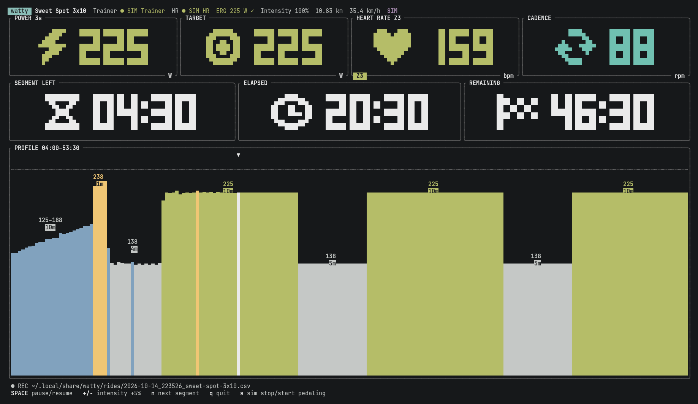
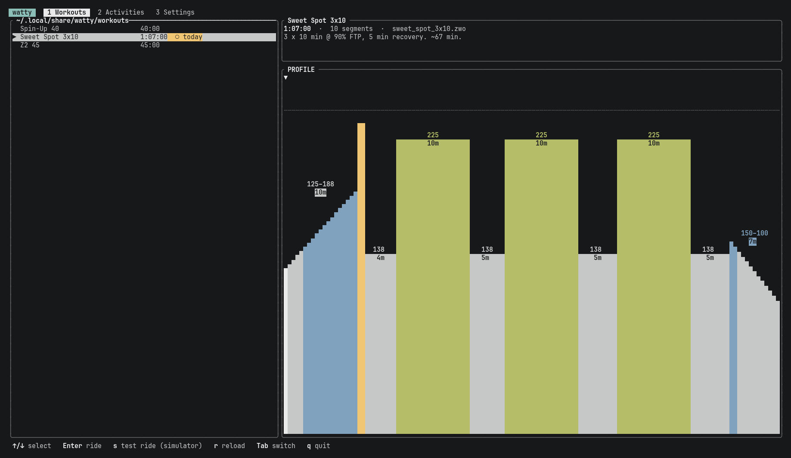
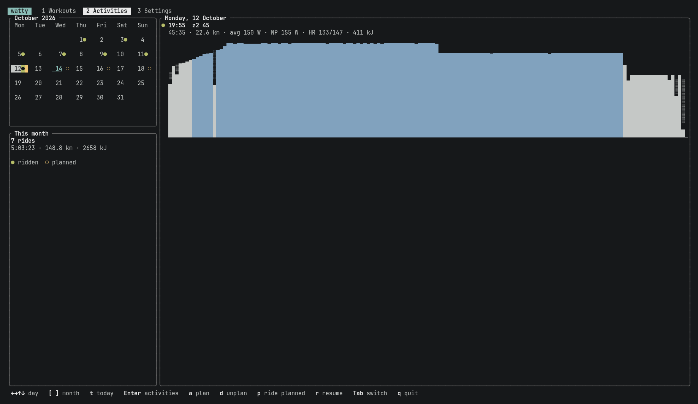
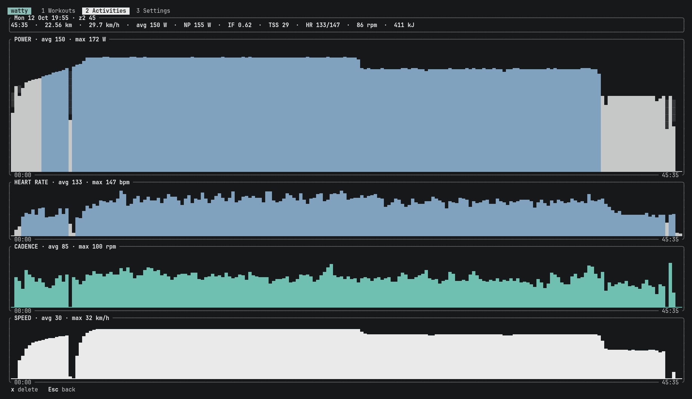
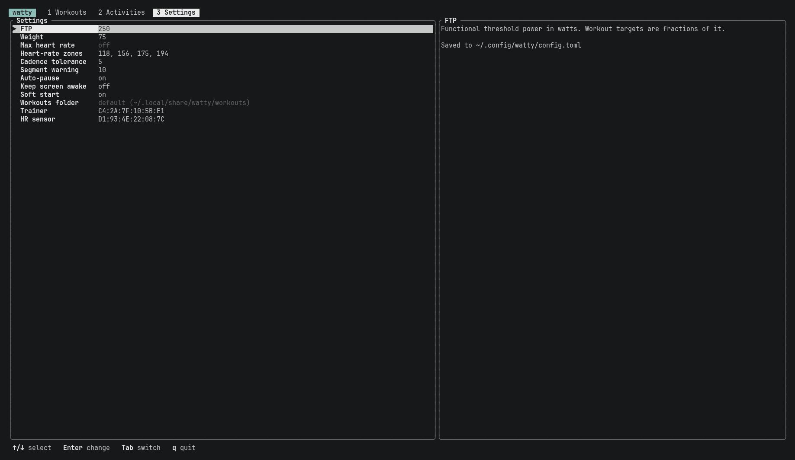

# watty

Indoor cycling in the terminal. watty controls an FTMS smart trainer in ERG mode, plays `.zwo` workouts, reads a BLE heart-rate strap and records every ride.



## Features

- **ERG workouts** from `.zwo` files: steady, ramps, intervals and cadence targets, with a soft start and a countdown before each segment change.
- **Live ride screen**: power, target, heart rate (colored by zone), cadence, time left and the workout profile with your actual power drawn over it.
- **Auto-pause** when you stop pedaling, `+`/`-` to adjust intensity, and a hint to back off when heart rate drifts too high on an endurance segment.
- **Recording** to CSV and TCX. An interrupted ride (crash, quit) can be resumed where it stopped.
- **Strava upload** of each saved ride, or any past ride from the calendar.
- **Calendar** of past rides and planned workouts, with per-ride stats (NP, IF, TSS) and charts.
- **Simulator** to try everything without a trainer.









## Install

Needs Linux with BlueZ and a Rust toolchain.

```sh
cargo build --release
./target/release/watty
```

Start a ride with `Enter` on the Workouts tab, or `s` for a test ride on the simulator. Missing FTP or weight takes you to Settings first; the trainer and HR sensor are picked from a device scan.

*Ramp test* is a workout like any other, so it can be planned in the calendar too: 5 min warmup, then ERG steps from 100 W, +20 W every minute, until the cadence stays below 55 rpm for 5 s. FTP is 75% of the best minute; press `f` at the end to save it. `<RampTest Warmup="300"/>` as the last element of any `.zwo` file does the same.

## Keys

| Ride | |
|---|---|
| `space` | start / pause |
| `+` `-` | intensity ±5% |
| `n` | next segment |
| `q` | quit (save or discard) |

| Activities | |
|---|---|
| `Enter` | ride details |
| `a` / `d` | plan / unplan a workout |
| `p` | ride the planned workout |
| `r` | resume an interrupted ride |
| `u` | upload a ride to Strava |
| `[` `]` / `t` | change month / today |

## Command line

```sh
watty scan                                   # find BLE devices
watty ride workouts/sweet_spot_3x10.zwo      # ride without the home screen
watty ride workouts/test_short.zwo --sim --speed 10
watty monitor --trainer <ADDR> --hr <ADDR>   # read-only data
watty erg --trainer <ADDR> --watts 100       # fixed ERG target
watty export ~/.local/share/watty/rides/<ride>.csv
watty strava connect                         # log in to Strava (also in Settings)
watty strava upload <ride>.csv
```

## Strava

Connect with `Enter` on *Strava* in Settings. Saved rides are then uploaded as trainer rides when they end (turn off with *Upload to Strava*); simulator rides never are.

watty needs your own Strava API app with `localhost` as the callback domain. Pass its credentials via `WATTY_STRAVA_CLIENT_ID` / `WATTY_STRAVA_CLIENT_SECRET`, or `strava_client_id` / `strava_client_secret` in `config.toml`. A new Strava app only accepts its owner until Strava raises its athlete limit.

## Files

| | |
|---|---|
| `~/.config/watty/config.toml` | settings (also editable in the Settings tab) |
| `~/.local/share/watty/workouts/` | `.zwo` workouts, seeded with examples |
| `~/.local/share/watty/rides/` | recorded rides (CSV + TCX); simulator rides in `test/` |
| `~/.local/share/watty/plan.toml` | planned workouts |
| `~/.local/share/watty/strava.json` | Strava tokens |
| `~/.local/share/watty/watty.log` | log |

The plan can be edited by hand:

```toml
[[workout]]
date = 2026-10-16
file = "sweet_spot_3x10.zwo"   # relative to the workouts folder, or absolute
```
